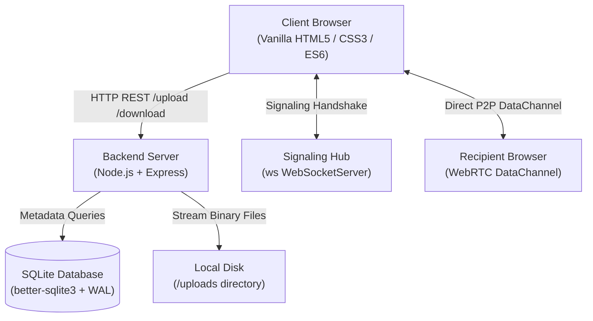
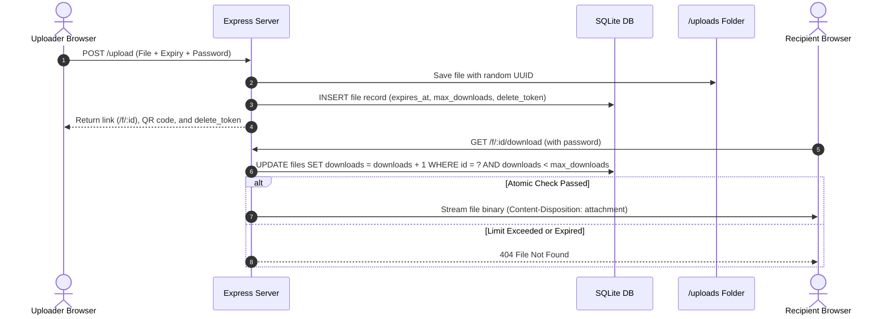
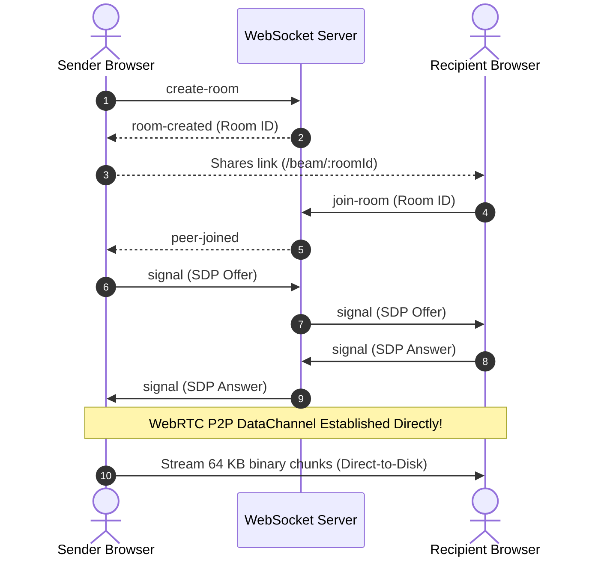
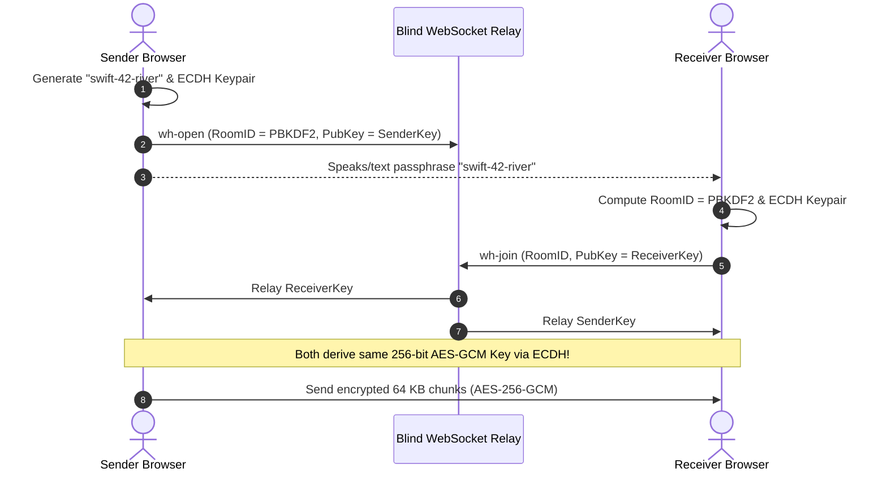

# LinkVault 🔐

[](https://nodejs.org/)
[](https://expressjs.com/)
[](https://www.sqlite.org/)
[](https://webrtc.org/)
[](https://w3c.github.io/webcrypto/)
[](https://jestjs.io/)
[](LICENSE)

> A privacy-first, zero-knowledge file sharing web app that supports expiring server links, unlimited direct peer-to-peer browser streaming, and end-to-end encrypted transfers with memorable passphrases.

---

## 1. Project Title & One-Line Description
**LinkVault** is a full-stack, privacy-first file sharing platform combining three distinct transfer engines: asynchronous temporary server vaults, unlimited browser-to-browser WebRTC streaming, and password-authenticated end-to-end encrypted Wormholes.

---

## 2. Problem It Solves / Why I Built It

### The Problem
Traditional file sharing tools (Google Drive, WeTransfer, Dropbox) suffer from three common issues:
1. **Privacy Concerns:** Centralized servers hold unencrypted files on their drives, leaving personal data vulnerable to leaks or data mining.
2. **Bandwidth & Storage Limits:** Free cloud tiers impose strict storage quotas (e.g. 2 GB caps) and throttle download speeds.
3. **Link Rot & Lingering Files:** People upload a file for a one-time transfer, but the file lingers on the server indefinitely because manual deletion is forgotten.

### Why I Built LinkVault
LinkVault was designed to give users complete control over their files with three tailored solutions:
- When you need to send a small file asynchronously (so you can close your computer): **Vault Share** holds it temporarily, enforces download limits, and deletes it automatically.
- When you need to send a massive 10 GB video directly to a colleague: **Direct Beam** streams it browser-to-browser with **zero server storage** and **unlimited file size**.
- When you are in the same room or on a phone call and want maximum security: **Magic Wormhole** encrypts the file end-to-end with AES-256-GCM using a memorable 3-word passphrase (like `swift-42-river`).

---

## 3. Features

- **📦 Vault Share (Server-Stored Ephemeral Links):**
  - Files up to 50 MB with customizable self-destruction timers (e.g., 30m, 2h, 7d).
  - Atomic one-time download limits (prevents race conditions when multiple people click the link simultaneously).
  - Optional password protection hashed with `bcryptjs`.
  - Secret `delete_token` returned to the uploader for early manual purging.
  - Background cleanup cron job that purges expired files and database records every 10 minutes.
  - Instant vector QR codes for quick camera scanning from mobile devices.

- **⚡ Direct Beam (Browser-to-Browser WebRTC Streaming):**
  - Completely bypasses the server: file flows peer-to-peer.
  - Unlimited file sizes (100 MB – 10 GB+).
  - Direct-to-Disk streaming via the **File System Access API** (`showSaveFilePicker`): RAM usage stays flat at ~2 MB even for huge files.
  - Backpressure flow control (`bufferedamountlow`) to prevent network congestion and browser tab crashes.
  - Mobile resilience: handles screen locking and backgrounding with automatic reconnection grace periods.

- **🔮 Magic Wormhole (PAKE & End-to-End Encryption):**
  - Human-friendly 3-word passphrases (e.g., `swift-42-river`) with 1.6+ million entropy combinations.
  - 128-bit Room ID derivation via PBKDF2 (50,000 iterations).
  - Ephemeral ECDH (P-256) key exchange over a blind WebSocket signaling relay.
  - AES-256-GCM authenticated encryption for every 64 KB chunk.
  - Automatic fallback: If strict symmetric NAT blocks direct WebRTC UDP traffic, it seamlessly switches to an Encrypted Blind Relay over WebSockets where the server only sees ciphertext.

---

## 4. Tech Stack (And Why Each Tool Was Chosen)



| Technology | Role | Why It Was Chosen |
|---|---|---|
| **Node.js** | Backend Runtime | Non-blocking event loop handles thousands of concurrent WebSocket connections and streaming uploads with minimal resource usage. |
| **Express.js** | Web Framework | Lightweight, battle-tested REST API routing with simple middleware support (`express-rate-limit`, `multer`). |
| **SQLite (`better-sqlite3`)** | Database | Synchronous, embedded relational database that runs in-process. Requires no external database servers to manage and supports Write-Ahead Logging (WAL) for high concurrency. |
| **WebSockets (`ws`)** | Real-Time Signaling | Full-duplex, low-latency communication required for WebRTC SDP offers/answers, ICE candidate exchange, and blind ciphertext relaying. |
| **WebRTC (`RTCDataChannel`)** | Peer-to-Peer Transport | Native browser protocol allowing direct device-to-device data transfer without uploading files to intermediate servers. |
| **Web Cryptography API** | End-to-End Encryption | Native browser `crypto.subtle` provides hardware-accelerated PBKDF2, ECDH P-256, and AES-256-GCM encryption with zero external JavaScript dependencies. |
| **Bcrypt (`bcryptjs`)** | Password Hashing | Industry standard adaptive hashing algorithm with salt rounds to prevent rainbow table attacks on password-protected files. |
| **Jest & Supertest** | Testing Suite | Automated testing framework for verifying REST API responses, concurrency race conditions, and WebSocket signaling behavior. |

---

## 5. Project Structure

```
LinkVault/
├── package.json              # Project dependencies, scripts, and engine configurations
├── server.js                 # Main HTTP server, REST endpoints, and WebSocket attachment
├── linkvault.db              # SQLite database file (created automatically at startup)
├── uploads/                  # Storage folder for temporary Vault Share files
├── src/
│   ├── auth.js               # Password hashing and constant-time password verification (bcrypt)
│   ├── cleanup.js            # Background cron job that cleans expired files from disk and DB
│   ├── db.js                 # SQLite database connection setup and table schemas
│   ├── files.js              # Database helper functions, atomic download increments, and queries
│   ├── limiter.js            # Rate limiting configuration (prevents DoS on uploads and downloads)
│   ├── signaling.js          # WebSocket server managing WebRTC and Wormhole room coordination
│   └── storage.js            # Multer disk upload configuration and human expiry string parsing
├── public/
│   ├── index.html            # Single-page web interface for all three sharing modes
│   ├── style.css             # Responsive styling, dark theme, and micro-animations
│   ├── app.js                # DOM controller: tab switching, upload handling, progress UI
│   ├── p2p.js                # WebRTC Direct Beam client engine with backpressure flow control
│   ├── p2p-cache.js          # Lightweight IndexedDB store for transfer resume metadata
│   ├── wormhole.js           # Wormhole engine: PBKDF2, ECDH key exchange, AES-256-GCM encryption
│   └── wordlist.js           # 128 adjectives and 128 nouns for generating friendly passphrases
└── tests/
    ├── fileshare.test.js     # 12 automated unit tests for Vault Share REST APIs and concurrency
    └── signaling.test.js     # 10 automated unit tests for WebRTC and Wormhole WebSocket signaling
```

---

## 6. How It Works (Step-by-Step Flow)

### Engine 1: Vault Share (Expiring Cloud Link)


### Engine 2: Direct Beam (P2P WebRTC Streaming)


### Engine 3: Magic Wormhole (End-to-End Encrypted Transfer)


---

## 7. Installation & How to Run It

### Prerequisites
- **Node.js**: v18.0.0 or higher (v20+ recommended)
- **npm**: v9.0.0 or higher
- Standard C/C++ build tools (for compiling native `better-sqlite3` bindings)

### Step 1: Clone the Repository
```bash
git clone https://github.com/HarK-github/LinkVault.git
cd LinkVault
```

### Step 2: Install Dependencies
```bash
npm install
```

### Step 3: Run the Server
```bash
# Start production server:
npm start

# Or start development server with live reload:
npm run dev
```

### Step 4: Open in Your Browser
Open your browser and navigate to:
```
http://localhost:3000
```

### Step 5: Run Automated Tests
```bash
npm test
```
*(Runs 22 comprehensive automated tests verifying uploads, downloads, concurrency limits, password verification, and signaling protocols).*

---

## 8. Example Usage / Sample Input & Output

### 1. Uploading a File via cURL (REST API)
```bash
curl -X POST http://localhost:3000/upload \
  -F "file=@sample.pdf" \
  -F "expiry=2h" \
  -F "max_downloads=1" \
  -F "password=secret123"
```

**Sample Output (201 Created):**
```json
{
  "id": "7b3a9c1482e01df4b791e84a",
  "download_url": "/f/7b3a9c1482e01df4b791e84a",
  "full_url": "http://localhost:3000/f/7b3a9c1482e01df4b791e84a",
  "delete_token": "a18ef4b2089c253d867c4e5f90123abc",
  "original_name": "sample.pdf",
  "size": 245890,
  "has_password": true,
  "expires_at": 1772658400000,
  "max_downloads": 1,
  "created_at": 1772651200000
}
```

### 2. Downloading a Password-Protected File
```bash
curl -X POST http://localhost:3000/f/7b3a9c1482e01df4b791e84a/download \
  -H "Content-Type: application/json" \
  -d '{"password":"secret123"}' \
  --output downloaded_sample.pdf
```

### 3. Immediate Deletion via Secret Token
```bash
curl -X DELETE http://localhost:3000/f/7b3a9c1482e01df4b791e84a \
  -H "x-delete-token: a18ef4b2089c253d867c4e5f90123abc"
```

**Sample Output (200 OK):**
```json
{
  "success": true,
  "message": "File deleted successfully"
}
```

---

## 9. Challenges Faced & How They Were Solved

### Challenge 1: The "Check-Then-Act" Race Condition in Download Limits
- **The Problem:** When a file has a maximum download limit of 1, if 20 people click the link at the exact same millisecond, a standard server would read `downloads = 0`, allow all 20 users to download, and then increment `downloads = 20`.
- **The Solution:** We eliminated this race condition by using a single atomic SQL statement in SQLite:
  ```sql
  UPDATE files
  SET downloads = downloads + 1
  WHERE id = ? AND (max_downloads IS NULL OR downloads < max_downloads);
  ```
  SQLite guarantees this executes atomically. Only the first request modifies 1 row (`changes === 1`); all subsequent simultaneous requests modify 0 rows (`changes === 0`) and receive a 404 response.

### Challenge 2: Browser Memory Exhaustion on Multi-Gigabyte Transfers
- **The Problem:** In WebRTC, if you read a 5 GB file into JavaScript memory, the browser tab runs out of memory and crashes.
- **The Solution:** We implemented two cooperating mechanisms:
  1. **Backpressure Flow Control:** We slice the file into 64 KB pieces. If `dataChannel.bufferedAmount > 1 MB`, reading pauses and waits for the browser's `onbufferedamountlow` event before reading the next piece.
  2. **File System Access API (`showSaveFilePicker`):** On the receiving side, incoming chunks are streamed directly into a file handle on disk. RAM usage remains flat at ~2 MB regardless of whether the file is 50 MB or 20 GB.

### Challenge 3: Symmetric NAT & Firewall Blocks in WebRTC
- **The Problem:** On certain cellular networks and corporate Wi-Fi, symmetric NAT prevents browsers from establishing direct UDP connections.
- **The Solution:** We built a dual-transport fallback inside the Wormhole engine. If the WebRTC DataChannel fails to establish within 4 seconds, the system seamlessly activates an **Encrypted Blind Relay** over WebSockets. The file chunks are encrypted with AES-256-GCM in the browser, and the server blindly forwards the ciphertext. The server never has the decryption key, preserving end-to-end privacy.

### Challenge 4: Mobile Screen Locking & App Switching
- **The Problem:** On iOS Safari and Android Chrome, switching to another app or locking the screen terminates active WebSocket connections immediately.
- **The Solution:** We added a 60-second disconnect grace timer on the signaling server, paired with client-side listeners for `visibilitychange`, `online`, and `focus`. When the user unlocks their phone, the client automatically sends a `reconnect` packet, restoring the transfer without data loss.

---

## 10. Future Improvements

1. **TURN Server Integration (coturn):** Deploy a self-hosted open-source TURN relay for 100% direct WebRTC connectivity across restrictive corporate firewalls.
2. **Chunk Checksumming (Blake3 / SHA-256):** Add per-chunk cryptographic hashes so that interrupted transfers can verify individual chunks rather than re-transmitting slices.
3. **Multi-File / Folder Bundling:** Support transferring whole directories by streaming ZIP archives on-the-fly using browser Web Streams.
4. **Offline Local Peer Discovery:** Use mDNS or Web Bluetooth to discover nearby devices on the same local Wi-Fi without needing internet access.

---

## 📄 License
This project is open-source and licensed under the **ISC License**.
