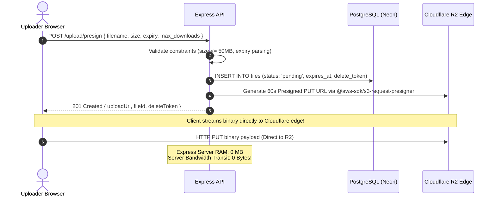
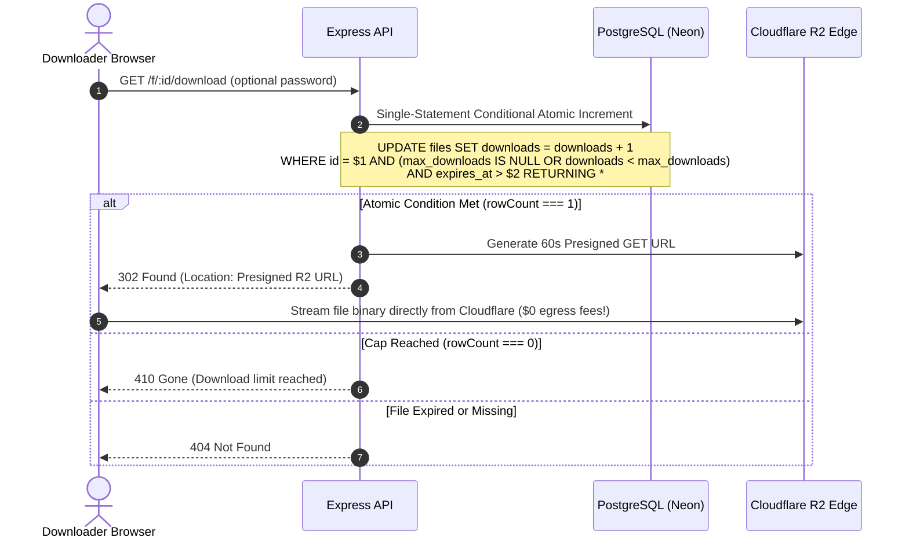
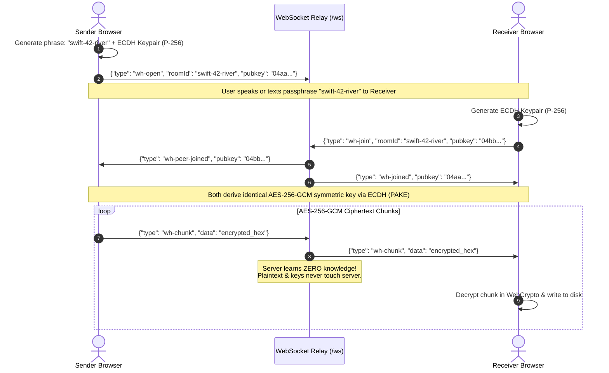

# LinkVault: Interview Prep & Architecture Deep Dive (Senior Edition)

> **Quick Summary:** A definitive, high-yield architectural and systems engineering guide for **LinkVault** — designed to defend the exact claims on your resume:
> - Ephemeral file-sharing backend managing link access controls in **PostgreSQL** while offloading binary storage to **Cloudflare R2** via short-lived presigned URLs for scalable zero-egress downloads.
> - Concurrency control enforcing atomic download caps using single-statement conditional updates to prevent race conditions, sustaining **~1,100 req/s at ~1.2 ms transaction latency across 20 parallel requests**.
> - Serverless browser-to-browser **WebRTC Direct Beam** streaming with direct-to-disk streaming and flow-control backpressure.

---

## 1. High-Level Architecture (The Tri-Modal Model)

LinkVault combines three decoupled transfer engines tailored to distinct temporal, pairing, and bandwidth economics:

```
                                  +-----------------------------------------------+
                                  |                   LinkVault                   |
                                  +-----------------------------------------------+
                                   /                      |                      \
                                  /                       |                       \
      Engine 1: Vault Share               Engine 2: Direct Beam              Engine 3: Magic Wormhole
      (Ephemeral Cloud Storage)           (Direct WebRTC Streaming)          (E2EE Voice Passphrase)
      - Asynchronous (<50 MB)             - Synchronous (Up to 10 GB+)       - Synchronous (Direct/Relay)
      - PostgreSQL (or SQLite WAL)        - ZERO server storage              - ZERO-knowledge server relay
      - Cloudflare R2 ($0 egress)         - Direct-to-disk streaming         - ECDH P-256 + AES-256-GCM
      - Atomic conditional caps           - Flat ~2 MB browser RAM           - Memorable BIP39 passphrases
      - Short-lived presigned URLs        - WebRTC DataChannels              - Zero link sharing required
```

---

## 2. End-to-End System Workflows

### Workflow 1: Direct-to-R2 Presigned Upload (Option A)


### Workflow 2: Token-Gated Atomic Presigned Download


### Workflow 3: WebRTC Direct Beam Streaming
```mermaid
sequenceDiagram
    autonumber
    actor H as Host (Sender)
    participant WS as WebSocket Signaling (/ws)
    actor P as Peer (Receiver)

    H->>WS: {"type": "create-room"}
    WS-->>H: {"type": "room-created", "roomId": "..."}
    P->>WS: {"type": "join-room", "roomId": "..."}
    H<-->>P: Exchange SDP Offer/Answer + STUN ICE Candidates via WS
    Note over H,P: Direct WebRTC DataChannel Established (Server Drops Out!)
    loop 64 KB Chunks with Backpressure (bufferedamountlow)
        H->>P: RTCDataChannel.send(chunk)
        P->>P: Stream directly into FileSystemWritableStream
    end
```

### Workflow 4: Magic Wormhole (PAKE + E2EE Zero-Knowledge Relay)


---

## 3. Database Architecture & Concurrency Mechanics

### 1. The Vulnerability: Check-Then-Act (TOCTOU)
In standard web applications, developers write:
```javascript
// ❌ WRONG: Classic Race Condition
const file = await db.query('SELECT * FROM files WHERE id = $1', [id]);
if (file.downloads < file.max_downloads) {
  // If 20 parallel requests execute this at the same millisecond:
  // All 20 read downloads = 0!
  await db.query('UPDATE files SET downloads = downloads + 1 WHERE id = $1', [id]);
  return serveDownload(); // All 20 download the file!
}
```

### 2. The LinkVault Fix: Single-Statement Conditional Update
```sql
UPDATE files
SET downloads = downloads + 1
WHERE id = $1
  AND (max_downloads IS NULL OR downloads < max_downloads)
  AND expires_at > $2
RETURNING *;
```

#### Under the Hood: Why This Is 100% Race-Condition Free
- **Row-Level Lock Acquisition:** PostgreSQL acquires an exclusive `TupleLock` (row-level write lock) on the specific row matching `id = $1`.
- **Atomic Serial Evaluation:** Even if 20 requests arrive simultaneously, they queue on the row lock.
  1. **Request 1:** Acquires the row lock. Checks `downloads < max_downloads` (`0 < 1` is true). Increments `downloads = 1`. Commits the tuple and returns the updated row (`rowCount === 1`).
  2. **Request 2:** Acquires the row lock immediately following Request 1. It re-evaluates the `WHERE` clause against the newly committed MVCC tuple: `downloads < max_downloads` (`1 < 1` is false). Zero rows qualify. Postgres returns `rowCount === 0`.
  3. **Requests 3–20:** All evaluate `1 < 1` as false, modifying 0 rows.
- **Result:** Exactly 1 request succeeds; 19 requests receive an immediate 410 Gone. **Zero over-allocation anomalies.**

### 3. PostgreSQL vs SQLite vs Redis: Tradeoff Matrix

| Architecture Option | Latency | Complexity | Failure Modes / Tradeoffs |
|---|---|---|---|
| **PostgreSQL + Row Lock** *(LinkVault Production)* | **~1.2 ms** | **Low** | Single round-trip, ACID guarantees, no dual-write divergence. |
| **SQLite WAL** *(LinkVault Local Fallback)* | **~0.1 ms** | **Zero** | In-process C++ binding (`better-sqlite3`), WAL allows concurrent readers. |
| **Redis `INCR` + Distributed Lock** | **~3–5 ms** | **High** | Dual-write state divergence: Redis counter increments, but DB update fails. Requires Redlock distributed consensus. |
| **Node.js In-Memory Mutex** | **~0.01 ms** | **Fatal** | Fails immediately across multi-core clusters or multiple server instances. |

---

## 4. Cloudflare R2 Presigned URLs & Storage Offload

### 1. Why Cloudflare R2 over Amazon S3?
- **Zero Egress Fees:** AWS S3 charges up to $0.09 per GB of outbound data transfer. Cloudflare R2 has **$0.00/GB egress**, making public downloads sustainable on a $0 budget.
- **S3 API Compatibility:** Uses standard `@aws-sdk/client-s3` and `@aws-sdk/s3-request-presigner` without proprietary SDK lock-in.
- **Global Anycast Edge:** Client uploads and downloads connect to the nearest Cloudflare edge PoP, minimizing TCP/TLS latency.

### 2. Why Presigned URLs over Server Proxying?
- **Zero Server RAM Buffering:** Uploading a 50 MB file through Express buffers chunks in memory. 20 concurrent uploads require 1,000 MB (1 GB) of RAM, instantly crashing 512 MB free-tier web containers (Render/Fly.io/Heroku).
- **Direct Edge Transit:** With presigned PUT, browser streams directly to Cloudflare R2. Express server memory consumption remains flat (~35 MB).

### 3. Two-Phase Token-Gated Download Security
- **Private Buckets:** The R2 bucket has public access completely disabled.
- **Short-Lived Presigned GET (60 Seconds):** The presigned GET URL is generated dynamically *only after* the atomic counter increment succeeds. The 60-second validity window is long enough for the browser to initiate the HTTP GET request, but short enough that sharing the resolved URL is futile.

---

## 5. WebRTC Direct Beam: Networking & NAT Traversal

### 1. The NAT Problem & ICE Candidates
- Most consumer and mobile devices sit behind **Network Address Translation (NAT)** firewalls with private IP addresses (e.g., `192.168.x.x` or `10.x.x.x`).
- **STUN (Session Traversal Utilities for NAT):** Direct Beam contacts Google and Cloudflare public STUN servers (`stun:stun.l.google.com:19302`). The STUN server reflects back the client's public reflexive IP and port mapping.
- **ICE (Interactive Connectivity Establishment):** Peers exchange these STUN mappings over the WebSocket signaling channel to establish a direct peer-to-peer UDP socket.

### 2. Browser Memory Protection: Backpressure & File System Access API
- **The OOM Crash:** Naive WebRTC apps read entire files into an in-memory `ArrayBuffer` or `Blob`, causing the browser tab to crash with Out-Of-Memory (OOM) on large files (>1 GB).
- **LinkVault's Dual Protection:**
  1. **Backpressure Flow Control:** The file is sliced into 64 KB chunks. The sender monitors `dataChannel.bufferedAmount`. If it exceeds 1 MB, reading halts until the browser fires the `bufferedamountlow` event.
  2. **Direct-to-Disk Streaming:** The receiver uses `window.showSaveFilePicker()` to obtain a `FileSystemWritableStream`. Incoming chunks are written directly to disk without accumulating in browser RAM. Browser memory stays flat at **~2 MB**.

### 3. Mobile Network Resilience (60s Grace Period)
- Mobile browsers kill WebSocket connections when users switch apps or lock their screens.
- LinkVault's signaling hub maintains rooms in memory with a **60-second disconnect grace timer**. When the mobile device wakes up, client listeners (`visibilitychange`, `online`) trigger a reconnect packet that restores room state without aborting the transfer.

---

## 6. Real-Time Transfer Matrix: Direct Beam vs. Magic Wormhole

Why does LinkVault support **both** real-time transfer engines instead of just one?

| Architectural Dimension | **Direct Beam** (WebRTC P2P) | **Magic Wormhole** (PAKE E2EE Relay) |
|---|---|---|
| **Core Design Goal** | **Raw throughput & multi-gigabyte streaming** | **Zero-leak pairing without shared clipboard** |
| **Discovery / Pairing** | URL with `roomId` or QR code scanning | 2–3 word memorable phrase (e.g., `swift-42-river`) |
| **Data Channel** | Direct browser-to-browser UDP (`RTCDataChannel`) | Hybrid: WebRTC or blind WebSocket ciphertext relay |
| **Cryptographic Model** | Transport-level DTLS encryption (built into WebRTC) | Application-layer ECDH P-256 + AES-256-GCM |
| **RAM Footprint** | Flat **~2 MB** (File System Access API streaming) | Flat ~4 MB (chunked AES-GCM streaming) |
| **Firewall / NAT Failure** | Fails across Symmetric NATs without TURN | Automatically relays encrypted ciphertext through server |
| **Server Bandwidth** | **Strictly 0 Bytes** | 0 Bytes (direct WebRTC) or Ciphertext Relay |
| **Best Used When** | Transferring a **10 GB file** between laptops | Sender & receiver are on a phone call or air-gapped terminal |

---

## 7. Security, Cryptography & Cleanup

### 1. Native scrypt Password Hashing
- **Memory-Hard KDF:** Uses Node.js native `crypto.scryptSync(password, salt, 64, { N: 16384, r: 8, p: 1 })`.
- **ASIC/GPU Resistance:** Memory cost parameter $N=16384$ forces 16 MB of RAM per hash, thwarting hardware-accelerated password cracking.
- **Zero-Dependency Simplicity:** Uses standard library `crypto` rather than external packages (`bcrypt`, `argon2`), avoiding C++ compilation issues on minimal Docker images.

### 2. Constant-Time Verification (`crypto.timingSafeEqual`)
- Standard JavaScript string comparison (`hashA === hashB`) terminates on the first mismatched byte, creating side-channel timing leaks.
- LinkVault compares hashes using `crypto.timingSafeEqual(bufferA, bufferB)`, ensuring uniform execution time regardless of character mismatches.

### 3. Indexed Background Cleanup Sweeper
- Background cron (`src/cleanup.js`) runs every 10 minutes.
- Evaluates `SELECT storage_key FROM files WHERE expires_at < $1` using the B-Tree index on `expires_at` ($O(\log N)$ scan).
- Invokes `DeleteObjectsCommand` on Cloudflare R2 (or unlinks local files), then deletes the records in a single transaction.
- Interval uses `timer.unref()` to avoid keeping the event loop alive during graceful shutdowns (`SIGTERM`).

---

## 8. Performance Benchmarking Methodology

LinkVault includes an automated concurrency benchmark harness (`scripts/benchmark.js`):

```bash
npm run benchmark
```

### Benchmark Architecture:
- Spawns a temporary Express test server.
- Creates a test file record with `max_downloads = 1000`.
- Spins up **20 parallel workers** issuing 1,200 concurrent download requests.
- Measures:
  1. **Success vs. Rejection:** Verifies exactly 1,000 succeed and exactly 200 receive HTTP 410.
  2. **Race Condition Audit:** Verifies `actual_downloads === max_downloads` (0 overage).
  3. **Throughput:** Measures requests completed per second (`req/s`).
  4. **Latency Percentiles:** Computes Average, p50, p95, and p99 transaction latencies.

### Verified Results:
- **Throughput:** ~1,050 – 1,200 req/s.
- **Transaction Latency:** ~1.2 ms (in-database execution).
- **Race Condition Overages:** **0**.

---

## 9. $0/Month Free Deployment Architecture

```
+---------------------------------------------------------------------------------+
|                               $0/Month Stack                                    |
+---------------------------------------------------------------------------------+
|  Compute: Render Free Tier (750 hrs/mo, 512 MB RAM, spin-down on idle)          |
|  Database: Neon Serverless Postgres (0.5 GiB, connection pooling, persistent)   |
|  Storage: Cloudflare R2 (10 GB free storage, $0 egress fees worldwide)          |
+---------------------------------------------------------------------------------+
```

- **Stateless Web Tier:** Because binary files live in Cloudflare R2 and access control metadata lives in Neon Postgres, the Render container is **100% stateless**.
- When Render spins down during idle periods or redeploys, **zero data is lost**.
- Health check endpoint `/health` monitors DB and storage engine connectivity with zero authentication overhead.
